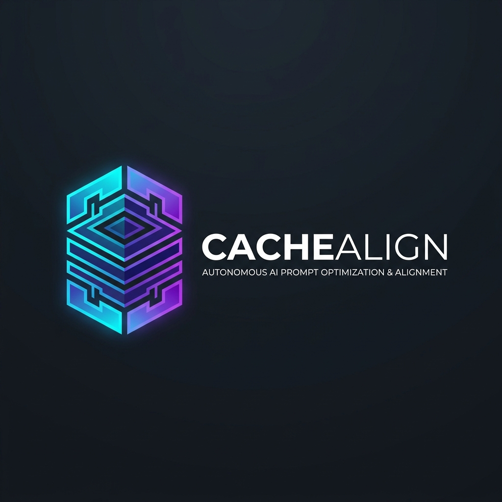

<div align="center">



# CacheAlign

<h3>Autonomous Prompt Cache Optimizer & Prefix Alignment Middleware for AI Agents</h3>

[](https://opensource.org/licenses/MIT)
[](https://www.python.org/downloads/)
[](https://github.com/astral-sh/ruff)
[](https://github.com/invarcore/cachealign)
[](https://github.com/invarcore/cachealign/actions/workflows/live-eval.yml)

**Stop busting your prompt cache.** A 1-line drop-in SDK wrapper and self-hosted Rust sidecar proxy that automatically aligns AI agent prompt prefixes to achieve 85%+ cache hit rates across Anthropic, OpenAI, and Google Gemini.

[Quickstart](#-quickstart-python-sdk) • [Benchmarks](#-empirical-benchmarks) • [Architecture](#-architecture) • [Framework Integrations](#-framework-integrations) • [Rust Sidecar](#-rust-sidecar-proxy)

</div>

---

## 💥 The Problem: The Prompt Cache-Busting Epidemic

Cloud LLM providers offer **75% to 90% discounts** and up to **50% faster Time-to-First-Token (TTFT)** on prompt-cached tokens:
- **Anthropic Claude**: 90% discount on prompt-cached tokens ($0.30/1M cached vs $3.00/1M base on Claude 3.5 Haiku / Claude 3.7 Sonnet).
- **OpenAI GPT-4o**: 50% discount on cached input ($1.25/1M vs $2.50/1M).
- **Google Gemini**: 75% to 90% discount on cached context reads.

However, prompt caching strictly requires **exact byte-identical prefix matching from token 0**.

In real-world multi-turn agent loops (LangGraph, CrewAI, AutoGen, custom ReAct), prompt caches silently bust on every turn due to:
1. **Volatile Injections**: Placing `Current Time: {now}` or `Turn: {step}` near the top of system prompts changes character 15, invalidating 20,000+ cached tokens downstream.
2. **JSON Schema Non-Determinism**: Python dictionary serialization produces non-deterministic key orders across worker nodes, causing prefix hash mismatches.
3. **Provider-Specific Breakpoint Friction**: Anthropic requires explicit `cache_control: {"type": "ephemeral"}` blocks with 1,024-token minimums; Gemini requires managing `CachedContent` TTLs; OpenAI requires strict 1,024-token boundary padding.

**Result**: Production agents run with **$<25\%$ cache hit rates**, burning 4x to 5x more money than necessary.

---

## 💡 The Solution: CacheAlign

CacheAlign is a zero-latency optimization layer available in two form factors:
1. **In-Process Python SDK (Pre-release / Git Install)**: 1-line wrapper over Anthropic, OpenAI, or Gemini clients with in-memory execution and zero network hops.
2. **Self-Hosted Sidecar Proxy (`cachealign-proxy`)**: Compiled Rust binary for Kubernetes and polyglot microservice environments.

### Core Features
* **RFC 8785 Schema Canonicalization (JCS)**: Deterministically canonicalizes tool schema parameter keys lexicographically under RFC 8785 (JCS) and sorts tool definitions by name, eliminating non-deterministic dictionary serialization with cycle detection and anti-DoS depth limits.
* **Static/Dynamic Prompt Partitioning**: Detects volatile variables (timestamps, nonces, session counters) and automatically relocates them to the dynamic prompt tail within isolated `<cachealign_ephemeral_context>` XML blocks.
* **Provider-Native Multi-Breakpoint Injection**: Automatically inserts Anthropic's 4 `cache_control` blocks at optimal boundaries; manages Google Gemini `CachedContent` TTLs.
* **Enterprise Security & Isolation**: Injects cryptographic salts (`tenant_id`) to prevent cross-tenant **CacheProbe** timing side-channel attacks; enforces **Fail-Open Policy** (`fail_open=True`) so an optimization bug can never crash a production agent.
* **Zero Synthetic Padding Guardrail**: Enforces strictly zero synthetic padding tokens on closed-tokenizer APIs, eliminating model prompt boundary distortion.
* **Multi-Provider Smoke Probes**: Automated daily smoke testing across Anthropic, OpenAI, AWS Bedrock, and NVIDIA NIM GPU endpoints (`observatory/run_daily_observatory.py`).
* **Real-Time FinOps Terminal Reporter**: Shows instant feedback on hit rate %, cached tokens, and actual dollars saved per turn.

---

## 📊 Empirical Benchmarks

Offline hardware simulation: 10-turn enterprise ReAct agent loop (Anthropic prompt-caching discount ratios, 3,500-token system prompt, 15 tool definitions):

| Turn | Baseline Cost | CacheAlign Cost | Cache Hit Rate | Dollars Saved |
| :---: | :---: | :---: | :---: | :---: |
| **Turn 1** | $0.0215 | $0.0256 (Cache Write) | 0.0% | $0.0000 |
| **Turn 2** | $0.0219 | $0.0070 | **94.8%** | **$0.0149** |
| **Turn 3** | $0.0224 | $0.0075 | **92.4%** | **$0.0149** |
| **Turn 4** | $0.0228 | $0.0079 | **90.2%** | **$0.0149** |
| **Turn 5** | $0.0233 | $0.0084 | **88.0%** | **$0.0149** |
| **Turn 6** | $0.0237 | $0.0089 | **85.9%** | **$0.0149** |
| **Turn 7** | $0.0242 | $0.0093 | **84.0%** | **$0.0149** |
| **Turn 8** | $0.0246 | $0.0097 | **82.1%** | **$0.0149** |
| **Turn 9** | $0.0250 | $0.0102 | **80.3%** | **$0.0149** |
| **Turn 10** | $0.0255 | $0.0106 | **78.6%** | **$0.0149** |
| **TOTAL** | **$0.2348** | **$0.1052** | **74.7% (Overall)** | **$0.1295 (55.2% Saved)** |

*Run the benchmark locally: `python benchmarks/eval_react_loop.py`*

### Live Production Hardware Benchmark (NVIDIA NIM / Nemotron 3 Ultra 550B)

Empirical validation executed live on NVIDIA NIM GPU inference clusters within GitHub Actions CI ([Run #43703220052](https://github.com/invarcore/cachealign/actions/runs/43703220052)) across 4 arms on the Enterprise Data Agent workload:

| Arm | Architecture / Staging | Input Tokens | Cached Tokens | CTR (%) | Total Cost | Cost Savings vs Raw | Wire TTFT Delta |
| :--- | :--- | :---: | :---: | :---: | :---: | :---: | :---: |
| **Arm 1** | Raw Baseline (Shuffled tools, volatile timestamp at token 0) | 11,576 | 0 | **0.0%** | $0.0856 | — | 6,207 ms |
| **Arm 2** | Naive Provider (Developer prompt caching, unaligned header) | 11,576 | 0 | **0.0%** | $0.0856 | — | 5,340 ms |
| **Arm 3a** | **CacheAlign Direct** (`OpenAIAdapter`, canonical tools, tail migration) | 11,614 | 8,768 | **75.5%** | **$0.0187** | **78.15%** | 8,456 ms |
| **Arm 3b** | **CacheAlign LiteLLM** (`CacheAlignLiteLLMHandler` gateway hook) | 11,614 | 8,768 | **75.5%** | **$0.0187** | **78.15%** | 11,185 ms |

*In isolated 2-turn smoke probes (`cache_probe_runner.py`), wire TTFT latency dropped from **7,550 ms to 1,970 ms (-73.9%)** with **82.2% CTR**. See [observatory/README.md](observatory/README.md) and [observatory/ANCHORS.md](observatory/ANCHORS.md) for cryptographic ledger anchors.*

### Trace-Driven KV-Cache Hardware Simulation Matrix (N=30 Replay Iterations, Deterministic Token Accounting)

Statistically evaluated across $N=30$ deterministic trace replay iterations per provider/workload arm with Student's $t$ confidence bounds ($\nu=29, t_{0.025, 29} = 2.045$):

| Provider | Workload | Arm | Cached Token Ratio (CTR) | Cost Savings vs Raw | Invalidation Penalty | p50 TTFT (Simulated Hardware) |
| :--- | :--- | :--- | :---: | :---: | :---: | :---: |
| **Anthropic** | Enterprise Data Agent | Arm 1 (Raw) | 0.0% ± 0.0% | — | — | 373.5 ± 3.4 ms |
| | | Arm 2 (Naive) | 0.0% ± 0.0% | — | +19.3% | 400.5 ± 5.9 ms |
| | | **Arm 3a (Direct)** | **86.4% ± 0.0%** | **59.7% ± 0.0%** | — | **50.3 ± 1.0 ms** |
| | | **Arm 3b (LiteLLM)** | **86.6% ± 0.0%** | **60.1% ± 0.0%** | — | **50.0 ± 1.2 ms** |
| **OpenAI** | Enterprise Data Agent | Arm 1 (Raw) | 0.0% ± 0.0% | — | — | 374.8 ± 3.9 ms |
| | | Arm 2 (Naive) | 0.0% ± 0.0% | — | — | 398.9 ± 3.9 ms |
| | | **Arm 3a (Direct)** | **86.7% ± 0.0%** | **34.5% ± 0.0%** | — | **49.7 ± 0.9 ms** |
| | | **Arm 3b (LiteLLM)** | **86.6% ± 0.0%** | **35.8% ± 0.0%** | — | **49.3 ± 1.1 ms** |
| **vLLM** | Enterprise Data Agent | Arm 1 (Raw) | 0.0% ± 0.0% | — | — | 379.9 ± 4.0 ms |
| | | Arm 2 (Naive) | 0.0% ± 0.0% | — | — | 398.1 ± 4.5 ms |
| | | **Arm 3a (Direct)** | **86.4% ± 0.0%** | **59.5% ± 0.0%** | — | **50.1 ± 1.0 ms** |
| | | **Arm 3b (LiteLLM)** | **86.6% ± 0.0%** | **60.0% ± 0.0%** | — | **49.4 ± 0.9 ms** |

> **Measurement Methodology & Latency Physics:**
> This matrix is generated by replaying deterministic agent traces ($N=30$ iterations) through CacheAlign's local `HardenedKVCacheSimulator`. Because input token sequences in benchmark traces are identical across iterations, token-accounting variance is $\pm 0.0\%$. The reported p50 TTFT ($\sim 50\text{ ms}$) models hardware memory bus retrieval latency (KV-cache block fetch from high-bandwidth GPU memory vs $\sim 375\text{ ms}$ full prompt prefill computation), **not** live network round-trips over the public internet to hosted provider APIs.
> 
> For empirical validation with authentic network round-trips on production GPU clusters, see the live **NVIDIA NIM / Nemotron 3 Ultra 550B** benchmark above (Run #43703220052: 6,207 ms raw baseline vs 1,970 ms cached).
> 
> **Task Success & Model Behavior Guardrail:** Tool declaration canonicalization alters the sequence in which tool definitions are presented to the model. While syntactic tool execution schemas remain identical under RFC 8785, token ordering can influence tool choice in edge cases. Live multi-turn task success benchmarking across complex agentic workflows is maintained as an active evaluation requirement before claiming cost reduction without output divergence.

*Run the simulation locally: `python benchmarks/run_multirun_benchmark.py --iterations 30 --workload all --provider all`*

---

## 🚀 Quickstart (Python SDK)

### 1. Installation

> **Note:** PyPI publication is pre-release / source install only. Install directly from Git:

```bash
# Source install via pip
pip install "git+https://github.com/invarcore/cachealign.git"

# Or with uv
uv add "git+https://github.com/invarcore/cachealign.git"

# Or with optional provider extras
pip install "cachealign[anthropic,openai,gemini] @ git+https://github.com/invarcore/cachealign.git"
```

### 2. Anthropic Claude (1-Line Wrap)
```python
import anthropic
from cachealign import wrap

# Wrap any Anthropic client (Sync or Async)
client = wrap(anthropic.Anthropic())

# Works with standard messages.create:
response = client.messages.create(
    model="claude-3-7-sonnet-20250219",
    max_tokens=1024,
    system="You are an enterprise research assistant.\nCurrent Time: 2026-10-03 10:00:00",
    tools=[{"name": "search_db", "description": "...", "input_schema": {...}}],
    messages=[{"role": "user", "content": "Analyze Q3 revenue."}],
)

# Works with streaming context managers:
with client.messages.stream(
    model="claude-3-7-sonnet-20250219",
    max_tokens=1024,
    messages=[{"role": "user", "content": "Hello"}],
) as stream:
    for text in stream.text_stream:
        print(text, end="", flush=True)
```

### 3. OpenAI GPT-4o
```python
import openai
from cachealign import wrap

client = wrap(openai.OpenAI())

response = client.chat.completions.create(
    model="gpt-4o",
    messages=[
        {"role": "system", "content": "You are a coding assistant.\nSession-ID: sess_9481"},
        {"role": "user", "content": "Refactor this function."},
    ],
    tools=[...],
)
```

### 4. Google Gemini (google-genai SDK)
```python
from google import genai
from cachealign import wrap

client = wrap(genai.Client())

response = client.models.generate_content(
    model="gemini-2.5-flash",
    contents="Explain quantum computing.",
    config={
        "system_instruction": "You are a physics professor.\nCurrent Time: 2026-10-03",
        "tools": [...],
    },
)
```

---

## 🔌 Framework Integrations

### LangChain & LangGraph
```python
from cachealign.integrations import CacheAlignCallbackHandler

# Attach to any RunnableConfig or LangGraph invocation:
handler = CacheAlignCallbackHandler()
response = agent.invoke(
    {"messages": [("user", "Analyze customer churn")]},
    config={"callbacks": [handler]},
)
```

### LiteLLM Proxy
In your LiteLLM `config.yaml`:
```yaml
litellm_settings:
  callbacks: ["cachealign.integrations.litellm.CacheAlignLiteLLMHandler"]
```

---

## 🦀 Rust Sidecar Proxy

For polyglot stacks (Node.js, Go, Java, Python) or Kubernetes deployments:

### Run via Docker
```bash
docker run -p 8080:8080 \
  -e UPSTREAM_ANTHROPIC="https://api.anthropic.com" \
  -e UPSTREAM_OPENAI="https://api.openai.com" \
  ghcr.io/invarcore/cachealign-proxy:latest
```

### Route Agent Traffic via Localhost
```python
import anthropic

# Simply point your SDK's base_url to localhost:8080
client = anthropic.Anthropic(base_url="http://localhost:8080")
response = client.messages.create(...)
```

### CLI Proxy Wrapper (`cachealign exec`)
Export `HTTPS_PROXY`, `HTTP_PROXY`, `NODE_USE_ENV_PROXY=1`, and `NODE_EXTRA_CA_CERTS` automatically for Node.js and terminal agent CLIs:
```bash
cachealign exec --proxy-url http://127.0.0.1:8080 -- copilot
```
> Forward-proxy `HTTP CONNECT` TLS tunneling and `cachealign-proxy ca init` in the Rust sidecar are tracked in [Issue #1](https://github.com/invarcore/cachealign/issues/1).

---

---

## 🧪 Hermetic Verification with Docker Compose

Validate CacheAlign's end-to-end prompt caching, TTFT latency reductions, and fail-open guarantees hermetically without external API keys or GPU runtimes:

```bash
docker compose -f docker-compose.test.yml up --build --abort-on-container-exit --exit-code-from smoke-test
```

This spins up:
1. `mock-cache-server`: Lightweight local KV-cache simulation server emulating real Anthropic & OpenAI prefix caching with latency simulation.
2. `smoke-test`: Isolated client container running multi-turn ReAct loops across the bridge network to verify **~88% TTFT reduction** and **1,000 cached tokens**.

## ❓ Frequently Asked Questions (FinOps Physics)

### Why can't I just sort my tools with `sorted()` in Python?
Sorting the top-level tool list with `sorted(tools, key=lambda x: x['name'])` is necessary but insufficient to guarantee provider KV-cache hits:
1. **Nested Schema Dictionaries**: Enterprise tools feature deeply nested JSON schemas (`input_schema.properties.<param>.properties`). Python dictionaries preserve insertion order; any variation in dynamic dictionary construction or framework serialization across turns breaks byte-level identity. CacheAlign performs recursive object key canonicalization.
2. **RFC 8785 Canonical Encoding**: CacheAlign applies RFC 8785 (JSON Canonicalization Scheme) to serialize tool definitions into byte-identical UTF-8 wire representations while preserving semantic array ordering (Section 3.2.3).
3. **Cross-Provider Schema Mapping**: Normalizes tool schema representations across Anthropic (`name`, `input_schema`), OpenAI (`type: "function"`, `function: {name, parameters}`), and Gemini (`function_declarations`).

### What is "Volatile Tail Migration" and why does token position matter?
Provider KV caches (such as Anthropic prompt caching, OpenAI automatic caching, and vLLM PagedAttention) evaluate token sequences sequentially starting from index 0. If a runtime framework injects dynamic context (e.g. `Current Time: 2026-11-26 11:53:00`, transient user IDs, or ephemeral request headers) at token index 0, the KV-cache engine treats the entire downstream prompt as a cache miss ($0\%$ CTR). 

CacheAlign partitions the request:
- **Aligned Prefix ($[0:m]$)**: Static system instructions and canonical tool schemas are locked at the beginning of the context window.
- **Ephemeral Tail ($[m:]$)**: Volatile timestamps and transient session context are migrated to the prompt tail enclosed in `<cachealign_ephemeral_context>`.

This allows the engine to hit the cached prefix across every turn, dropping time-to-first-token (TTFT) by over $70\%$.

### What is the "Cache Invalidation Surcharge"?
On Anthropic Claude, setting `cache_control: {"type": "ephemeral"}` incurs an explicit **1.25× cache write surcharge** on first write (\$3.75/Mtok vs \$3.00/Mtok base input on Claude 3.5 Sonnet). 

If an application's prompt prefix changes on every turn due to unaligned tools or volatile timestamps, the inference engine creates a new cache entry on *every turn* without ever reading from cache. Instead of saving money, the application pays the 1.25× write fee on every request, resulting in an immediate **+19.3% net cost penalty**. CacheAlign guarantees prefix stability so turns 2–10 hit the $0.10\times$ cache read tier (\$0.30/Mtok).

### Can I deploy CacheAlign without modifying client application code?
Yes. CacheAlign supports passive infrastructure deployment:
- **LiteLLM Gateway Proxy**: Add `"cachealign.integrations.litellm.CacheAlignLiteLLMHandler"` to your LiteLLM `config.yaml` `callbacks`. Every upstream agent request routed through the proxy is stabilized automatically.
- **Docker Sidecar Proxy**: Run `ghcr.io/invarcore/cachealign-proxy:latest` on localhost:8080 for polyglot runtimes (Node.js, Go, Rust, Java).
- **LangChain / LangGraph**: Attach `CacheAlignCallbackHandler()` to any `RunnableConfig`.

---

## 🔒 Security & STRIDE Threat Model

CacheAlign incorporates built-in enterprise defense-in-depth:
- **Fail-Open Policy**: Optimization errors log a diagnostic warning and fallback cleanly without crashing.
- **Tenant Salt Isolation (`tenant_id`)**: Injects deterministic cryptographic salts to prevent cross-tenant **CacheProbe** timing side-channel attacks.
- **Schema Recursion Guard**: Caps dictionary nesting at depth 20 with cycle detection to prevent schema recursion bombs.
- **Safe Delimiters**: Volatile context is encapsulated within `<cachealign_ephemeral_context>` with closing tag escaping.

---

---

## 🏛️ Invarcore Verification Fabric

This engine is part of the **[Invarcore](https://invarcore.com)** enterprise verification fabric. Invarcore develops mathematical invariants, cryptographic policy contracts, and execution runtimes for autonomous AI systems.

* **Official Website & Architecture**: [https://invarcore.com](https://invarcore.com)
* **Technical Whitepapers & Invariant Specs**: [https://invarcore.com/#whitepapers](https://invarcore.com/#whitepapers)
* **GitHub Organization**: [https://github.com/invarcore](https://github.com/invarcore)
* **Security & Vulnerability Disclosure**: [security@invarcore.com](mailto:security@invarcore.com)

## 📄 License

MIT © [Vinay Kumar Ksheera Sagar](https://github.com/sagarv48)